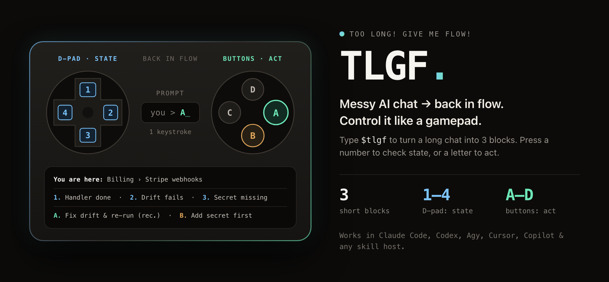
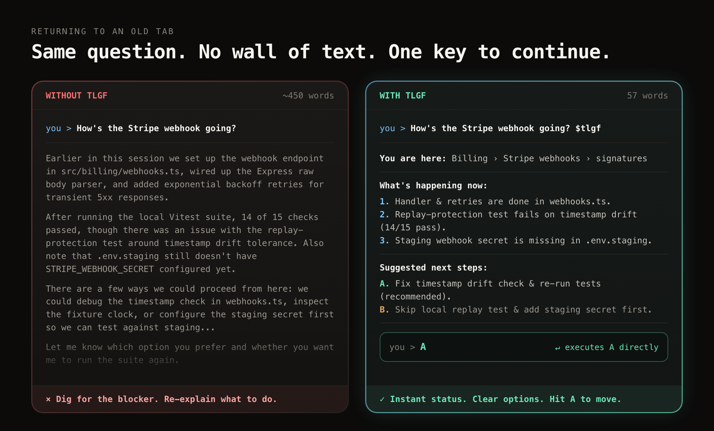
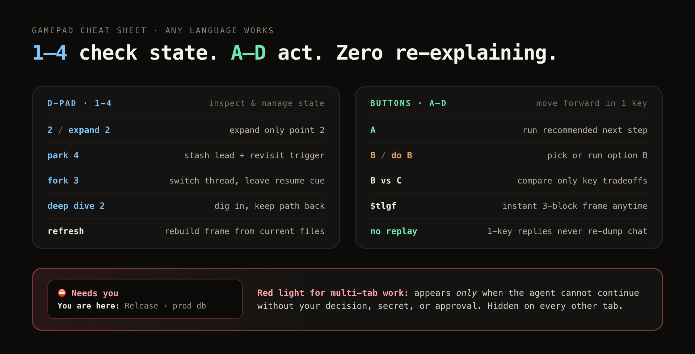

<h1 align="center">TLGF</h1>

<p align="center">
  
  
  
</p>

<p align="center">
  
</p>

<p align="center">
  <strong>2&times; more clean resumes (34/45 vs 17/45) &middot; 15/15 on Claude Code &middot; up to &minus;71% less reading</strong><br>
  <sub><a href="#install">Install</a> &middot; <a href="#controls">Cheat sheet</a> &middot; <a href="#numbers">Benchmark</a></sub>
</p>

---

When you run several AI tabs at once, coming back to an older chat usually means scrolling through screens of tool logs just to find what's stuck.

**TLGF** replaces that wall of text with the same 3-block frame every time:

- **You are here** — project, thread, and current step in one line.
- **What's happening now (`1–4`)** — what's done, what's running, what's blocked.
- **Suggested next steps (`A–D`)** — concrete options, recommended one first.

**Numbers check state. Letters act.**

---

## Before / After

<p align="center">
  
</p>

<details>
<summary>Copyable text version</summary>

<pre>
<b>you &gt;</b> <ins><b>How's the Stripe webhook going? $tlgf</b></ins>

<b>You are here:</b> Billing › Stripe webhooks › signatures
────────────────────────────────────────────────────────────
<b>What's happening now:</b>
1. Handler and retry logic are done in <code>src/billing/webhooks.ts</code>.
2. Replay-protection test fails on timestamp drift (14/15 pass).
3. Staging webhook secret is still missing in <code>.env.staging</code>.
────────────────────────────────────────────────────────────
<b>Suggested next steps:</b>
A. Fix the timestamp drift check in <code>webhooks.ts</code> and re-run tests (recommended).
B. Skip local replay tests for now and add the staging secret first.
────────────────────────────────────────────────────────────
<b>you &gt;</b> <ins><b>A</b></ins>
</pre>

</details>

---

## Install

Install globally in one command using the open-source [`skills` CLI](https://github.com/vercel-labs/skills):

```shell
npx skills@latest add https://github.com/alexfafula/skill-tlgf-too-long-give-me-flow/tree/main/tlgf -g -y -a <agent>
```

| Agent | CLI Flag |
| :--- | :--- |
| **Claude Code** | `-a claude-code` |
| **Codex CLI** | `-a codex` |
| **Agy (Antigravity CLI)** | `-a antigravity-cli` |
| **Cursor** | `-a cursor` |
| **GitHub Copilot** | `-a github-copilot` |
| **Windsurf** | `-a windsurf` |
| **Cline** | `-a cline` |
| **OpenCode** | `-a opencode` |

Then type `TLGF` or `$tlgf` anywhere in a prompt:

```text
$tlgf                         # instant status & next steps
resume retry fix $tlgf        # pick up parked work
status + test command $tlgf   # status + a deliverable
gdzie jesteśmy? $tlgf         # works in any language
```

<details>
<summary>Try without installing, update, or use without skill triggering</summary>

### Try for one session

```shell
# Claude Code
npx skills@latest use https://github.com/alexfafula/skill-tlgf-too-long-give-me-flow/tree/main/tlgf --agent claude-code

# Codex
npx skills@latest use https://github.com/alexfafula/skill-tlgf-too-long-give-me-flow/tree/main/tlgf --agent codex
```

### Update

```shell
npx skills@latest update tlgf
```

### Use without skill triggering

- **Claude Code output style:** Copy `adapters/claude/output-styles/tlgf.md` to `~/.claude/output-styles/` (or `.claude/output-styles/`), then run `/output-style TLGF` or set `"outputStyle": "TLGF"` in `settings.json`.
- **`AGENTS.md` block:** Paste `adapters/agents/tlgf.md` into your `AGENTS.md` (or equivalent rules file).

</details>

---

## Controls

<p align="center">
  
</p>

<details>
<summary>Text reference</summary>

| You type | TLGF does |
| :--- | :--- |
| `2` or `expand 2` | Expands only status point 2. |
| `B` or `do B` | Picks or runs step B (when safe and allowed). |
| `B vs C` | Compares only the real difference between B and C. |
| `park 4` | Saves point 4 as an inactive lead with evidence and when to revisit it. |
| `fork 3` | Switches active work to point 3 and leaves a resume note for the current thread. |
| `deep dive 2` | Investigates point 2 while keeping a clear path back. |
| `refresh` | Rebuilds the frame from current files and logs. |

</details>

---

## Numbers

<p align="center">
  
</p>

<p align="center">
  
</p>

Full method, fixtures, and raw judge scores are in [`TLGF_BENCHMARK.md`](TLGF_BENCHMARK.md):

- **2× more clean resumes:** 34/45 (76%) with TLGF vs 17/45 (38%) without it across 90 paired runs. On Claude Code, TLGF nailed 15/15 messy resumes (vs 5/15 without) while cutting response length by 13–71% on 4 of 5 cases.
- **Why agents break without it:** When you jump back into an old thread, default agents fail 62% of the time—replaying the whole status on a 1-letter `B`, missing stale saved state or hidden retries, and burying blockers.
- **Less reading, almost nothing missed:** Blind judges scored TLGF at 94–95% of critical facts kept (vs 77–84% without), with higher scores on knowing where you are (1.89–1.94/2) and what to do next (1.74–1.80/2).

---

## What it enforces

- **One thread at a time:** Only the active work stays visible; parked work shows up only if it affects the current path.
- **Numbers stay attached to context:** Results keep their run ID, model, retry state, or data limits.
- **No hidden retries:** If a task needed a retry to pass, say so—don't hide the first failure.
- **Real progress only:** Work is "running" only while it's actually running. Use real counts or milestones, never fake percentages.
- **Keep state between sessions:** When writes are allowed, TLGF keeps a tiny restart index in `.tlgf/STATE.md` and verifies it against your real branch and files before trusting it. Secrets and raw logs are never written there.
- **Portable paths & no meta-chatter:** Repo-relative paths only (no `file://` URLs), and replies never echo `TLGF` or explain how the skill works.

---

## FAQ

**Does it hijack normal questions?**  
No. Without `TLGF` / `$tlgf`, standalone questions ("what does idempotent mean in HTTP?") get a plain answer with no frame.

**Does it work in Polish or other languages?**  
Yes. Labels (`You are here`, `What's happening now`, `Suggested next steps`, `⛔ Needs you`) render naturally in your language while keeping code, branches, and file paths untouched.

**What if my agent doesn't support skills?**  
Copy `adapters/agents/tlgf.md` into your `AGENTS.md` (or use `adapters/claude/output-styles/tlgf.md` for Claude Code). Same rules, zero setup.

---

<details>
<summary>Repo layout & local validation</summary>

```text
skill-tlgf-too-long-give-me-flow/
├── tlgf/
│   ├── SKILL.md                 Core 3-block contract, gamepad controls, continuity rules
│   ├── agents/openai.yaml       Display metadata and default invocation
│   ├── references/
│   │   ├── addressable-flow.md  Resolving 1-4 and A-D references
│   │   ├── continuity.md        Park, resume, switch, triage, and signal routing
│   │   └── lineage.md           The .tlgf/STATE.md restart index
│   ├── evals/cases.json         12 behavior-evaluation cases
│   ├── scripts/check.py         Package validator
│   └── LICENSE.txt              License shipped with installed copies
├── adapters/                    Claude Code output style and AGENTS.md block
├── assets/                      README visuals + assets/render.py generator
├── benchmarks/                  Paired control-vs-TLGF harness, judge, and reports
├── docs/                        Product contract and forward tests
├── TLGF_BENCHMARK.md            Benchmark method and full results
├── CHANGELOG.md                 Version history
└── README.md                    This guide
```

Validate the local skill package:

```shell
python3 tlgf/scripts/check.py
# Expected: TLGF valid: triptych contract, 12 eval cases
```

</details>

---

## License

Created by [Aleksander Fafuła](mailto:aleksander@fafula.com).  
MIT License — see [LICENSE](LICENSE).

> [!NOTE]
> Independent open-source project by one developer, not affiliated with any AI vendor.
